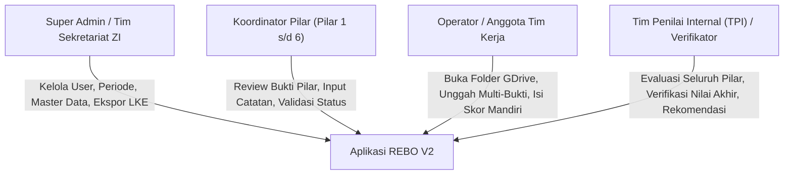
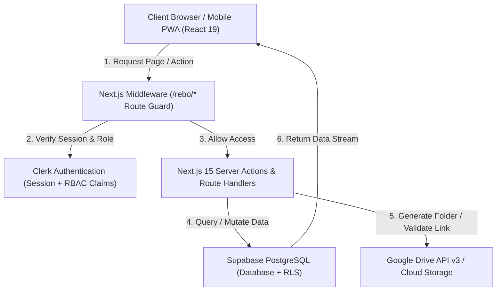
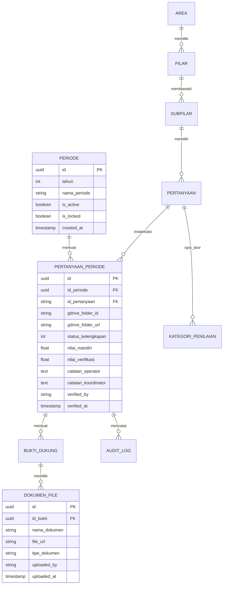

# PROJECT PRD & DEVELOPMENT PLAYBOOK
# REBO V2 — Reformasi Birokrasi & Zona Integritas Platform
### BPS Kabupaten Kepulauan Siau Tagulandang Biaro (Sitaro)

---

| Dokumen | Spesifikasi Produk & Panduan Eksekusi Bertahap (PRD & Playbook) |
|---|---|
| **Aplikasi** | REBO (Reformasi Birokrasi) V2 |
| **Instansi** | Badan Pusat Statistik (BPS) Kab. Kep. Siau Tagulandang Biaro |
| **Versi Dokumen** | 2.0.0 |
| **Status** | Ready for Development |
| **Target Platform** | Web App (Responsive Desktop & Mobile) + Progressive Web App (PWA) |
| **Model Pengerjaan** | Solo Developer + AI Coding Assistant (Vibe Coding with Guardrails) |
| **Tanggal Efektif** | November 2026 |

---

# DAFTAR ISI

- [PART A — PRODUCT REQUIREMENTS DOCUMENT (PRD)](#part-a--product-requirements-document-prd)
  - [1. Informasi Produk & Tech Stack](#1-informasi-produk--tech-stack)
  - [2. Ringkasan & Latar Belakang Masalah (Problem Statement)](#2-ringkasan--latar-belakang-masalah-problem-statement)
  - [3. Tujuan Produk (Product Goals)](#3-tujuan-produk-product-goals)
  - [4. Target Pengguna & Role-Based Personas](#4-target-pengguna--role-based-personas)
  - [5. Ruang Lingkup & Prioritas Fitur (MoSCoW Matrix)](#5-ruang-lingkup--prioritas-fitur-moscow-matrix)
  - [6. Kebutuhan Fungsional (Functional Requirements)](#6-kebutuhan-fungsional-functional-requirements)
  - [7. Spesifikasi Khusus: Sistem Google Drive Berjenjang per Indikator](#7-spesifikasi-khusus-sistem-google-drive-berjenjang-per-indikator)
  - [8. Kebutuhan Non-Fungsional (Non-Functional Requirements)](#8-kebutuhan-non-fungsional-non-functional-requirements)
  - [9. Struktur Navigasi & Information Architecture](#9-struktur-navigasi--information-architecture)
  - [10. Alur Kerja Pengguna (User Flows)](#10-alur-kerja-pengguna-user-flows)
  - [11. Desain Arsitektur Teknis](#11-desain-arsitektur-teknis)
  - [12. Model Data & Skema Database V2 (PostgreSQL / Supabase)](#12-model-data--skema-database-v2-postgresql--supabase)
  - [13. Keamanan, Autentikasi, & Tata Kelola Data](#13-keamanan-autentikasi--tata-kelola-data)
  - [14. Matriks Risiko & Mitigasi](#14-matriks-risiko--mitigasi)
- [PART B — SEQUENTIAL DEVELOPMENT PLAYBOOK](#part-b--sequential-development-playbook)
  - [Fase 1: Audit Keamanan Kritis & Pembersihan Kode Warisan (Legacy Cleanup)](#fase-1-audit-keamanan-kritis--pembersihan-kode-warisan-legacy-cleanup)
  - [Fase 2: Perombakan Skema Database & Migrasi Data V2](#fase-2-perombakan-skema-database--migrasi-data-v2)
  - [Fase 3: Penguatan Autentikasi, Role Metadata & Server Action RBAC](#fase-3-penguatan-autentikasi-role-metadata--server-action-rbac)
  - [Fase 4: Sistem Generator & Otomatisasi Google Drive per Indikator](#fase-4-sistem-generator--otomatisasi-google-drive-per-indikator)
  - [Fase 5: Rekonstruksi Form LKE & Multi-Evidence Management](#fase-5-rekonstruksi-form-lke--multi-evidence-management)
  - [Fase 6: Alur Verifikasi, Catatan Koordinator & Sistem Penilaian Ganda](#fase-6-alur-verifikasi-catatan-koordinator--sistem-penilaian-ganda)
  - [Fase 7: Dashboard Monitoring Real-Time, Audit Trail & Kanban Tindak Lanjut](#fase-7-dashboard-monitoring-real-time-audit-trail--kanban-tindak-lanjut)
  - [Fase 8: Ekspor Kertas Kerja LKE (Excel/PDF) & Dynamic Archive](#fase-8-ekspor-kertas-kerja-lke-excelpdf--dynamic-archive)
  - [Fase 9: Master Data CRUD & Manajemen Siklus Periode LKE](#fase-9-master-data-crud--manajemen-siklus-periode-lke)
  - [Fase 10: Pengujian Menyeluruh, Optimasi PWA, & Deployment Production](#fase-10-pengujian-menyeluruh-optimasi-pwa--deployment-production)
- [PART C — PROMPT TEMPLATES UNTUK AI CODING ASSISTANT](#part-c--prompt-templates-untuk-ai-coding-assistant)
- [PART D — TEST SCENARIOS & MATRIKS VERIFIKASI](#part-d--test-scenarios--matriks-verifikasi)
- [PART E — COMMAND CHEAT SHEET](#part-e--command-cheat-sheet)
- [PART F — DEFINITION OF DONE & CHECKLIST RILIS](#part-f--definition-of-done--checklist-rilis)

---

# PART A — PRODUCT REQUIREMENTS DOCUMENT (PRD)

# 1. Informasi Produk & Tech Stack

## 1.1 Identitas Produk
- **Nama Produk:** REBO (Zona Integritas & Reformasi Birokrasi Platform)
- **Versi:** 2.0.0
- **Instansi Pemilik:** BPS Kabupaten Kepulauan Siau Tagulandang Biaro (Sitaro), Sulawesi Utara
- **Tujuan Utama:** Digitalisasi, sentralisasi, otomasi penataan bukti dukung, pemantauan real-time, dan verifikasi Lembar Kerja Evaluasi (LKE) Zona Integritas menuju predikat Wilayah Bebas dari Korupsi (WBK) dan Wilayah Birokrasi Bersih dan Melayani (WBBM).

## 1.2 Tech Stack Terpilih

| Layer | Teknologi | Versi | Peran & Justifikasi |
|---|---|---|---|
| **Framework** | Next.js (App Router, Turbopack) | 15.3.x | Arsitektur modern, React Server Components (RSC), Server Actions aman, integrasi SEO & PWA |
| **Runtime & Bahasa** | React & TypeScript | React 19 / TS 5.7+ | Type-safety penuh, performa rendering optimal, penanganan formulir asinkron modern |
| **Styling & UI Kit** | Tailwind CSS v4 + shadcn/ui | Tailwind v4, Radix UI | Komponen aksesibel, responsif mobile/desktop, dukungan Dark/Light mode konsisten |
| **Autentikasi & RBAC** | Clerk Authentication | 6.12.x | Manajemen sesi aman, SSO, sinkronisasi profil, custom metadata untuk role & penugasan pilar |
| **Database & Storage** | Supabase (PostgreSQL) | PostgreSQL 15+ | Relasi data kuat, Row-Level Security (RLS), real-time capability, REST/PostgREST engine |
| **State & Data Table** | Zustand + TanStack Table v8 | Zustand 5, TanStack v8 | State UI global minimalis, paginasi dan filter tabel LKE yang cepat tanpa lag |
| **Validasi Skema** | Zod + React Hook Form | Zod 3.24+, RHF 7.54+ | Validasi formulir deklaratif pada sisi klien dan mutasi Server Actions di sisi server |
| **Visualisasi Data** | Recharts | 2.15+ | Grafik progress pemenuhan per pilar, radar chart capaian ZI, perbandingan skor |
| **Integrasi Eksternal** | Google Drive API v3 / URL Builder | REST v3 / Structured URL | Standardisasi pembuatan direktori folder bukti dukung per indikator secara otomatis |
| **Ekspor Laporan** | ExcelJS + jsPDF | Terbaru | Ekspor kertas kerja LKE format resmi KemenPAN-RB (.xlsx) & ringkasan eksekutif (.pdf) |
| **Observabilitas** | Sentry Next.js | 9.19+ | Pemantauan error production dan tracing latensi query database |
| **Aksesibilitas Mobile** | Next-PWA / Web App Manifest | Serenade / Custom | Dukungan instalasi PWA di smartphone pimpinan & koordinator lapangan |

---

# 2. Ringkasan & Latar Belakang Masalah (Problem Statement)

Pada implementasi **REBO V1**, sistem telah berhasil mendigitalkan daftar pertanyaan LKE dan memfasilitasi pengisian link bukti dukung. Namun, evaluasi operasional menunjukkan sejumlah hambatan kritis:

1. **Folder Google Drive Tercecer & Tidak Seragam:** Operator memasukkan link Google Drive personal atau link file acak. Tidak ada standarisasi penamaan folder, izin akses sering tertutup (*restricted access*), dan saat pergantian tahun data bukti bercampur aduk.
2. **Keterbatasan 1 Bukti per Pertanyaan:** Satu indikator LKE pada kenyataannya membutuhkan beberapa dokumen bukti (contoh: *Undangan*, *Daftar Hadir*, *Notula Rapat*, *Laporan Kegiatan*, *Dokumentasi Foto*). V1 hanya menyediakan 1 kolom teks tautan.
3. **Celah Keamanan & Akses:** Route `/rebo/admin` tidak terproteksi sempurna di middleware; endpoint `/api/status`, `/api/pilarHasil`, dan `/api/download` terbuka tanpa validasi sesi server-side; input catatan koordinator dan tombol status dapat ditekan oleh siapa saja.
4. **Tidak Ada Manajemen Periode (Multi-Year):** Data LKE tahun berjalan menimpa data tahun sebelumnya. Tidak ada riwayat evaluasi tahun 2024, 2025, 2026 yang terisolasi.
5. **Inkonsistensi Nilai & Perhitungan Progress:** Rumus persentase penyelesaian di dashboard monitoring tidak sinkron dengan bobot LKE nasional dan tidak memisahkan antara nilai usulan mandiri (*self-assessment*) dengan nilai verifikasi Tim Penilai Internal (TPI).
6. **Beban Kode Template:** Masih banyak artifak bawaan template dashboard e-commerce (`/dashboard/product`, sales stats, mock store) yang membingungkan alur aplikasi.

---

# 3. Tujuan Produk (Product Goals)

### 3.1 Business & Organizational Goals
- **100% Kesiapan Dokumen WBK/WBBM:** Mengeliminasi risiko dokumen tercecer atau berstatus *broken link* saat evaluasi oleh Tim Penilai Nasional (TPN) KemenPAN-RB dan BPS RI.
- **Efisiensi Waktu Penilaian Mandiri:** Mengurangi waktu pengumpulan dan verifikasi bukti dukung hingga 60% melalui otomasi pembuatan folder dan monitoring progres tersentralisasi.
- **Arsip Bukti Digital Multi-Tahun yang Rapi:** Menyimpan rekam jejak penilaian dari tahun ke tahun secara permanen tanpa risiko kehilangan data.

### 3.2 Technical & Quality Goals
- **Zero-Vulnerability RBAC:** Proteksi 100% pada route sensitif, Server Actions, dan API endpoint menggunakan validasi sesi Clerk + Supabase RLS.
- **Automated Directory Provisioning:** Otomatisasi pembentukan struktur folder Google Drive berjenjang: `Tahun > Area > Pilar > Subpilar > Indikator`.
- **High Performance:** LCP (Largest Contentful Paint) < 1.8 detik pada dashboard LKE dengan query relasi efisien (eliminasi *N+1 query*).

---

# 4. Target Pengguna & Role-Based Personas



| Role | Deskripsi Pengguna | Wewenang Utama | Batasan Akses |
|---|---|---|---|
| **Super Admin / Sekretariat ZI** | Kepala Kantor, Kasubbag Umum, atau Administrator IT | - Mengatur periode tahun evaluasi.<br>- Mengelola akun dan penugasan pilar pengguna.<br>- CRUD master data LKE (Pilar, Subpilar, Indikator, Bobot).<br>- Ekspor menyeluruh kertas kerja LKE (.xlsx / .pdf). | Tidak dibatasi. |
| **Koordinator Pilar** | Ketua Tim Kerja Pilar 1 s.d. 6 (Manajemen Perubahan, Tata Laksana, SDM, Akuntabilitas, Pengawasan, Pelayanan Publik) | - Memantau capaian pilar yang diampu.<br>- Memverifikasi dokumen bukti operator.<br>- Menyetujui (*Approve*) atau Menolak (*Reject* dengan Catatan Revisi).<br>- Menentukan nilai usulan pilar. | Hanya dapat mengedit & memvalidasi pertanyaan di pilar yang ditugaskan kepadanya. |
| **Operator / Anggota Tim** | Staf anggota tim kerja masing-masing pilar | - Melihat daftar indikator pilar masing-masing.<br>- Membuka tautan folder Google Drive terstandar per indikator.<br>- Mengunggah multi-dokumen bukti dukung.<br>- Mengisi self-assessment (penilaian mandiri) beserta catatan usulan. | Tidak dapat mengubah status persetujuan, tidak dapat mengisi Catatan Koordinator. |
| **Tim Penilai Internal (TPI)** | Verifikator independen / Auditor Internal BPS | - Memeriksa kesesuaian dokumen bukti terhadap standar KemenPAN-RB.<br>- Mengisi kolom Nilai Verifikasi Akhir & Rekomendasi Perbaikan.<br>- Memberikan penilaian objektif sebelum diajukan ke tingkat nasional. | Read-only pada pengunggahan bukti; wewenang tulis hanya pada skor verifikasi dan reviu TPI. |

---

# 5. Ruang Lingkup & Prioritas Fitur (MoSCoW Matrix)

### Must Have (Wajib untuk V2 Launch)
- Perbaikan total celah keamanan route middleware & API authorization.
- Fitur Multi-Periode / Multi-Tahun Evaluasi (Aktifkan tahun 2025, 2026, dst).
- Standarisasi & Generator Link Folder Google Drive per Indikator LKE.
- Multi-Evidence Document Management (1 pertanyaan memuat multi tautan dokumen spesifik).
- Pemisahan hak akses form input (Catatan Koordinator & Aksi Status hanya untuk Koordinator/Admin/TPI).
- Perhitungan progress & skor otomatis sesuai bobot LKE resmi KemenPAN-RB (Area Pemenuhan + Reform).
- Pembersihan seluruh kode warisan template e-commerce yang tidak relevan.
- Ekspor Kertas Kerja LKE ke Microsoft Excel (.xlsx) dengan formatting rapi.

### Should Have (Sangat Dianjurkan)
- Audit Trail / Riwayat Perubahan Bukti Dukung (siapa mengunggah, kapan disetujui/ditolak, log revisi).
- Modul Kanban Tindak Lanjut terintegrasi otomatis untuk pertanyaan yang berstatus *Ditolak / Perlu Revisi*.
- Komparasi visual skor: Nilai Mandiri (*Self-Assessment*) vs Nilai Verifikasi TPI pada Dashboard.
- Halaman Arsip Dinamis berbasis database (SK Tim, Lembar Kerja terdahulu, SOP, Pedoman).

### Could Have (Nilai Tambah)
- Integrasi otomatis Google Drive API (Service Account) untuk membuat folder langsung dari tombol aplikasi tanpa setup manual.
- Notifikasi email / in-app badge ketika bukti dukung ditolak oleh koordinator dengan catatan revisi.
- Ringkasan Eksekutif evaluasi berkala dalam format PDF siap cetak.

### Won't Have (Di Luar Cakupan V2)
- Penyimpanan file biner dokumen langsung di storage database lokal (semua dokumen tetap memanfaatkan Google Drive Cloud Storage demi efisiensi kuota server).
- Sistem absensi atau manajemen anggaran kantor (fokus eksklusif pada instrumen ZI / LKE).

---

# 6. Kebutuhan Fungsional (Functional Requirements)

| Kode FR | Modul | Kebutuhan Fungsional & Kriteria Penerimaan |
|---|---|---|
| **FR-01** | **Autentikasi & RBAC** | Sistem mengautentikasi pengguna via Clerk. Metadata pengguna (`role`, `assigned_pilar_id`) menentukan izin akses antarmuka dan hak eksekusi Server Action. |
| **FR-02** | **Multi-Periode LKE** | Admin dapat membuat periode tahun baru (misal: 2025, 2026). Pengguna dapat berpindah tahun evaluasi melalui dropdown switcher di navbar/header. Data LKE tahun lampau berstatus read-only jika periode telah dikunci (*closed*). |
| **FR-03** | **Generator Folder GDrive** | Setiap indikator/pertanyaan memiliki tautan folder Google Drive unik dengan format path terstandar. Admin/Koordinator dapat men-generate tautan folder terstruktur untuk seluruh pertanyaan secara massal atau per pilar. |
| **FR-04** | **Input Multi-Bukti** | Operator dapat menambahkan lebih dari 1 file bukti pada satu pertanyaan (contoh: Surat Tugas, Notula, Daftar Hadir). Tiap item bukti memiliki label nama dokumen, URL file Google Drive spesifik, dan tanggal unggah. |
| **FR-05** | **Alur Verifikasi Bukti** | Koordinator pilar dapat mengubah status indikator: `Belum Diisi` (0), `Diajukan / Menunggu Review` (1), `Disetujui` (2), `Perlu Revisi / Ditolak` (3). Form Catatan Koordinator wajib diisi jika status diubah menjadi `Perlu Revisi`. |
| **FR-06** | **Perhitungan Nilai Ganda** | Sistem menghitung dua metrik nilai secara otomatis: (1) Nilai Mandiri (skor opsi yang dipilih operator dikalikan bobot), dan (2) Nilai Verifikasi (skor yang disetujui TPI/Koordinator). |
| **FR-07** | **Monitoring Dashboard** | Dashboard visual menampilkan kartu ringkasan total progress (%), grafik batang capaian per pilar, diagram pie status kelengkapan bukti, dan tabel detail per subpilar. |
| **FR-08** | **Audit Trail / Log Aktivitas** | Setiap tindakan (input bukti, perubahan link, perubahan status verifikasi, pengeditan nilai) tersimpan dalam log audit dengan data user ID, nama pengguna, timestamp, dan ringkasan perubahan. |
| **FR-09** | **Ekspor Kertas Kerja LKE** | Sistem dapat mengunduh dokumen Excel (.xlsx) dengan struktur tabel berjenjang (Area, Pilar, Subpilar, Pertanyaan, Nilai Maksimal, Nilai Mandiri, Nilai Verifikasi, Link Bukti, Catatan). |
| **FR-10** | **Kanban Tindak Lanjut** | Daftar pertanyaan berstatus `Perlu Revisi` otomatis tampil pada kolom *To Do* pada Kanban Board agar tim pilar dapat segera menindaklanjuti sebelum batas waktu penilaian. |
| **FR-11** | **Master Data Management** | Super Admin memiliki akses penuh untuk menambah, mengedit deskripsi, mengatur bobot, dan menonaktifkan indikator pertanyaan pada menu `/rebo/dataRB`. |
| **FR-12** | **Arsip Digital Dinamis** | Modul `/rebo/arsip` menampilkan daftar dokumen penting (SK Tim ZI, Pedoman PMPRB, SOP) terklasifikasi per tahun yang dapat diunggah dan dikelola oleh Admin. |

---

# 7. Spesifikasi Khusus: Sistem Google Drive Berjenjang per Indikator

## 7.1 Standarisasi Penamaan Folder Google Drive
Untuk memastikan konsistensi dan kemudahan akses para evaluator nasional/internal, struktur direktori Google Drive diatur secara hierarkis:

```text
[DRIVE BPS SITARO - ZI & RB]
│
└── 📁 REBO_[TAHUN] (Contoh: REBO_2026)
    ├── 📁 01_AREA_PEMENUHAN
    │   ├── 📁 PILAR_I_MANAJEMEN_PERUBAHAN
    │   │   ├── 📁 SUBPILAR_A_TIM_KERJA
    │   │   │   ├── 📁 IND_01_Pembentukan_Tim_Kerja
    │   │   │   └── 📁 IND_02_Penentuan_Anggota_Tim
    │   │   └── 📁 SUBPILAR_B_RENCANA_PEMBANGUNAN_ZI
    │   │       ├── 📁 IND_03_Dokumen_Rencana_Kerja
    │   │       └── ...
    │   ├── 📁 PILAR_II_PENATAAN_TATALAKSANA
    │   ├── 📁 PILAR_III_PENATAAN_SISTEM_MANAJEMEN_SDM
    │   ├── 📁 PILAR_IV_PENGUATAN_AKUNTABILITAS
    │   ├── 📁 PILAR_V_PENGUATAN_PENGAWASAN
    │   └── 📁 PILAR_VI_PENINGKATAN_KUALITAS_PELAYANAN_PUBLIK
    │
    └── 📁 02_AREA_REFORM
        ├── 📁 PILAR_I_MANAJEMEN_PERUBAHAN
        └── ...
```

## 7.2 Logika Generator Link Folder Indikator
Sistem menyediakan 2 mode implementasi generator:

1. **Mode A: Google Drive API Integration (Automated Provisioning via Service Account)**
   - Backend memanggil Google Drive API v3 saat Admin menginisiasi tahun periode evaluasi baru.
   - Script membuat folder hierarki dan membagikan (*share*) izin view/edit ke domain `@bps.go.id`.
   - ID folder yang dihasilkan disimpan ke kolom `gdrive_folder_id` dan `gdrive_folder_url` pada tabel `indikator_periode`.
2. **Mode B: Standardized URL Mapping & Batch Link Importer**
   - Jika kredensial Service Account belum terkonfigurasi, sistem menyediakan template struktur folder via Google Apps Script (GAS) sekali klik.
   - Admin dapat menempelkan URL Root Folder tahun bersangkutan, dan sistem memetakan deep-link folder anak secara otomatis berdasarkan kode indikator.
3. **User Experience di Sisi Operator:**
   - Pada setiap kartu indikator pertanyaan di Form LKE, terdapat tombol aksi jelas:
     `[ 📂 Buka Folder Bukti GDrive ]` yang langsung membuka direktori indikator terkait di tab baru.
   - Terdapat tombol `[ 📋 Salin Link Folder ]` untuk kemudahan membagikan ke anggota tim kerja.

---

# 8. Kebutuhan Non-Fungsional (Non-Functional Requirements)

| Kategori | Parameter | Target Spesifikasi |
|---|---|---|
| **Keamanan** | Autentikasi & Autorisasi | - Proteksi middleware pada seluruh path `/rebo/*` dan `/api/*`.<br>- Server Action memverifikasi hak akses berdasarkan Clerk Session Claims.<br>- RLS aktif pada seluruh tabel Supabase. |
| **Performa** | Loading Speed & Efisiensi Query | - FCP (First Contentful Paint) < 1.2 detik.<br>- LCP < 1.8 detik pada halaman form pilar.<br>- Zero N+1 query: fetch data pilar menggunakan nested relation join Supabase tunggal. |
| **Ketersediaan** | Uptime & Aksesibilitas | - 99.9% uptime selama masa pengisian dan evaluasi LKE.<br>- Berjalan lancar di jaringan kantor dengan caching statis aset via Next.js. |
| **PWA & Mobile** | Akses Perangkat Bergerak | - Responsive penuh hingga layar smartphone (360px).<br>- Installable PWA dengan app icon dan splash screen resmi BPS Sitaro. |
| **Integritas Data** | ACID & History | - Perubahan status dan nilai tersimpan transaksional.<br>- Soft delete pada master data pertanyaan agar riwayat tahun lama tidak terputus. |

---

# 9. Struktur Navigasi & Information Architecture

```text
/ (Root Landing Page - Pengenalan REBO & Status Zona Integritas)
├── /auth
│   ├── /sign-in (Clerk Login Page)
│   └── /sign-up (Clerk Register Page)
│
└── /rebo (Protected Portal - Membutuhkan Login)
    ├── /overview (Ringkasan Eksekutif, Capaian ZI, Quick Stats)
    ├── /monitoring (Dashboard Progres, Grafik Komparasi, Radar Chart)
    │
    ├── /formRB (Formulir Pengisian Bukti & Evaluasi)
    │   ├── /area (Pilihan Area: Pemenuhan vs Reform)
    │   ├── /pemenuhan (Daftar Pilar 1 s.d. 6 Area Pemenuhan)
    │   ├── /reform (Daftar Pilar 1 s.d. 6 Area Reform)
    │   └── /[pilarId] (Detail Indikator Pertanyaan, Multi-Bukti, Validasi)
    │
    ├── /pilarHasil (Penginputan Nilai Indeks Hasil: Integritas & Pelayanan)
    ├── /kanban (Board Tindak Lanjut Bukti Revisi & To-Do List)
    ├── /arsip (Katalog Digital SK Tim, Pedoman, & Kertas Kerja Resmi)
    ├── /informasi (Panduan Pengisian, Jadwal Evaluasi, & FAQ)
    │
    └── /admin (Khusus Super Admin & Tim Sekretariat)
        ├── /periode (Manajemen Siklus Tahun Evaluasi & Kunci Periode)
        ├── /users (Manajemen Akun, Role, & Penugasan Pilar)
        ├── /master-lke (CRUD Pilar, Subpilar, Pertanyaan, Bobot)
        ├── /gdrive-generator (Tool Inisiasi Folder Google Drive Otomatis)
        ├── /audit-log (Jejak Aktivitas & Riwayat Verifikasi)
        └── /ekspor (Pusat Unduh Kertas Kerja Excel & PDF)
```

---

# 10. Alur Kerja Pengguna (User Flows)

### Flow 1: Pengisian Bukti Dukung oleh Operator
1. Operator login via Clerk -> Memilih tahun evaluasi aktif di header (misal: 2026).
2. Membuka menu **Form RB** -> Memilih Area & Pilar yang ditugaskan.
3. Pada indikator pertanyaan yang dituju:
   - Klik tombol **"Buka Folder GDrive"** untuk mengunggah berkas ke direktori terstandar.
   - Kembali ke aplikasi, klik **"Tambah Dokumen Bukti"** -> Masukkan nama berkas & tautan file spesifik.
   - Memilih opsi kategori penilaian (*self-assessment*).
   - Menuliskan catatan/penjelasan usulan bukti dukung.
   - Klik **"Simpan & Ajukan Verifikasi"** (Status berubah menjadi `Diajukan / Menunggu Review`).

### Flow 2: Verifikasi & Catatan oleh Koordinator Pilar / TPI
1. Koordinator membuka **Form RB** pada pilar yang diampunya.
2. Filter indikator dengan status `Menunggu Review`.
3. Memeriksa kecukupan berkas pada link Google Drive yang disematkan.
4. Jika berkas lengkap & valid:
   - Pilih status **"Disetujui"**, masukkan nilai verifikasi jika ada penyesuaian.
5. Jika berkas belum sesuai:
   - Pilih status **"Perlu Revisi"**, wajib menuliskan poin revisi pada **Catatan Koordinator**.
   - Indikator otomatis muncul pada Kanban Board tim pilar dengan label prioritas.

---

# 11. Desain Arsitektur Teknis



---

# 12. Model Data & Skema Database V2 (PostgreSQL / Supabase)

### 12.1 Entitas & Relasi Database V2



### 12.2 Kamus Status Kelengkapan LKE

| Kode Status | Label Status | Warna Indikator | Makna Bisnis |
|---|---|---|---|
| **0** | `Belum Diisi` | Gray / Muted | Indikator belum diisi opsi skor atau link dokumen bukti oleh operator. |
| **1** | `Menunggu Review` | Amber / Warning | Dokumen bukti telah diunggah dan diajukan untuk diperiksa koordinator. |
| **2** | `Disetujui` | Emerald / Success | Dokumen bukti telah diperiksa dan disetujui oleh Koordinator/TPI. |
| **3** | `Perlu Revisi` | Rose / Destructive | Dokumen ditolak/kurang lengkap; memerlukan tindak lanjut perbaikan dari tim. |

---

# 13. Keamanan, Autentikasi, & Tata Kelola Data

1. **Perbaikan Middleware Next.js:**
   - Memperbaiki matcher route admin dari `['/admin(.*)']` menjadi `['/rebo/admin(.*)']`.
   - Menggunakan asynchronous check: `const session = await auth();` untuk menghindari *unhandled promise rejection*.
2. **Server-Side Authorization pada Server Actions:**
   - Setiap mutasi data (update bukti, ubah status, simpan skor) memverifikasi `session.userId` dan `session.sessionClaims.metadata.role`.
   - Pemisahan ketat: Operator tidak dapat memicu aksi `updateStatusKelengkapan` atau mengubah field `catatan_koordinator`.
3. **Penyimpanan Tautan & Sanitasi Input:**
   - Seluruh URL Google Drive divalidasi formatnya menggunakan regex Zod (`z.string().url().regex(/drive\.google\.com/)`).
   - Mencegah *Cross-Site Scripting (XSS)* pada kolom catatan dengan sanitasi string.

---

# 14. Matriks Risiko & Mitigasi

| Risiko Potensial | Dampak | Probabilitas | Rencana Mitigasi |
|---|---|---|---|
| **Izin Akses Google Drive Terkunci** | Verifikator eksternal tidak dapat membuka dokumen bukti. | Sedang | Sistem menampilkan panduan hak akses "Siapa saja yang memiliki link dengan domain @bps.go.id dapat melihat" pada form upload. |
| **Perubahan Formula Bobot LKE dari KemenPAN-RB** | Perhitungan nilai total tidak valid. | Rendah | Formula bobot disimpan dinamis pada tabel `kategori_penilaian` dan `pilar` di database, bukan hardcoded pada file frontend. |
| **Batas Kuota Request Google Drive API** | Inisiasi folder massal terhenti sementara. | Rendah | Menggunakan batch request dengan delay/exponential backoff atau opsi generator link URL berbasis skema penamaan terstandar. |
| **Pergantian Anggota Tim Kerja ZI** | Bukti dukung hilang atau terisolasi di akun lama. | Sedang | Sentralisasi kepemilikan folder di Drive Tim ZI BPS Sitaro (Shared Drive resmi kantor), bukan drive akun pribadi staf. |

---

# PART B — SEQUENTIAL DEVELOPMENT PLAYBOOK

Playbook ini dirancang untuk dieksekusi secara berurutan dalam **10 Fase**. Setiap fase memiliki tugas terukur, instruksi kerja, dan kriteria penyelesaian (*Definition of Done*).

---

## FASE 1: Audit Keamanan Kritis & Pembersihan Kode Warisan (Legacy Cleanup)

### 1.1 Tujuan
Menutup seluruh celah keamanan rute publik dan membuang kode/halaman bawaan template yang tidak berhubungan dengan sistem REBO.

### 1.2 Daftar Tugas
- [ ] Perbaiki file `src/middleware.ts`:
  - Ubah matcher admin menjadi `/rebo/admin(.*)`.
  - Pastikan pengecekan role `await auth()` berjalan aman dengan fallback redirect ke `/rebo/overview`.
- [ ] Tambahkan autentikasi pada API Routes yang masih aktif (`/api/status`, `/api/pilarHasil`, `/api/download`) atau refactor ke Server Actions.
- [ ] Hapus file dan folder sisa template yang tidak digunakan:
  - `src/app/dashboard/product`
  - `src/app/dashboard/overview/@sales`
  - Komponen data dummy penjualan (`recent-sales.tsx`, dll).
- [ ] Bersihkan file `.husky/pre-push copy` yang usang.
- [ ] Sinkronkan `env.example.txt` agar mencakup variabel Clerk, Supabase, dan Sentry yang sebenarnya digunakan.

### 1.3 Verifikasi (Definition of Done)
- Membuka URL `/rebo/admin` dengan akun non-admin berhasil dialihkan (*redirected*).
- Menembak endpoint API tanpa token autentikasi menghasilkan status `401 Unauthorized`.
- `pnpm lint` dan `pnpm build` berjalan sukses tanpa error referensi modul yang hilang.

---

## FASE 2: Perombakan Skema Database & Migrasi Data V2

### 2.1 Tujuan
Mempersiapkan struktur basis data Supabase untuk mendukung multi-periode, multi-bukti dokumen, dan pencatatan riwayat audit.

### 2.2 Daftar Tugas
- [ ] Buat file SQL migration di Supabase:
  - Tabel `periode_evaluasi` (id, tahun, nama, is_active, is_locked).
  - Tabel `pertanyaan_periode` (junction antara pertanyaan master dan periode aktif, memuat folder gdrive, status, dan nilai).
  - Tabel `dokumen_bukti` (mendukung banyak tautan dokumen per pertanyaan).
  - Tabel `audit_log` (merekam jejak pengubahan data).
- [ ] Setup Row-Level Security (RLS) policies pada tabel baru:
  - Read access: seluruh pengguna terautentikasi.
  - Write access bukti: operator pilar terkait dan admin.
  - Write access verifikasi & catatan koordinator: koordinator pilar terkait, TPI, dan admin.
- [ ] Perbarui definisi tipe TypeScript di `src/types/rebo.ts` agar selaras dengan skema baru.

### 2.3 Verifikasi (Definition of Done)
- Skema terpasang di Supabase dengan RLS aktif.
- Data master pertanyaan V1 berhasil terpetakan ke dalam periode aktif pertama (misal: 2025/2026).
- Tipe TypeScript di `src/types/rebo.ts` tidak memiliki error `any`.

---

## FASE 3: Penguatan Autentikasi, Role Metadata & Server Action RBAC

### 3.1 Tujuan
Menerapkan sistem peran pengguna (Super Admin, Koordinator Pilar, Operator, TPI) berbasis Clerk Public Metadata dan Server Actions.

### 3.2 Daftar Tugas
- [ ] Definisikan skema metadata pengguna di Clerk:
  ```json
  {
    "role": "admin" | "koordinator" | "operator" | "tpi",
    "assigned_pilar_id": "1" | "2" | "3" | "4" | "5" | "6" | null
  }
  ```
- [ ] Buat utility helper `src/lib/auth/rbac.ts` untuk memeriksa hak akses user di Server Components dan Server Actions:
  - `getCurrentUserRole()`
  - `canEditPertanyaan(pilarId)`
  - `canVerifyPertanyaan(pilarId)`
- [ ] Implementasikan halaman kelola user sederhana di `/rebo/admin/users` untuk menetapkan role dan pilar staf.

### 3.3 Verifikasi (Definition of Done)
- Pengguna login menerima state role yang benar.
- Operator yang membuka pilar di luar tugasnya hanya memiliki hak *Read-Only*.

---

## FASE 4: Sistem Generator & Otomatisasi Google Drive per Indikator

### 4.1 Tujuan
Mewujudkan standarisasi direktori bukti dukung dengan 1 link folder khusus untuk setiap indikator LKE secara tersistematisasi per tahun.

### 4.2 Daftar Tugas
- [ ] Rancang modul utilitas `src/lib/gdrive/generator.ts`:
  - Fungsi pembuat URL struktur folder berdasarkan kode indikator:
    `[Root_URL_Tahun]/[Area]/[Pilar]/[Subpilar]/[Kode_Indikator]`.
  - Fungsi pembentuk nama folder standar: `IND_[KODE] - [DESKRIPSI_SINGKAT]`.
- [ ] Tambahkan modul inisiasi folder di `/rebo/admin/gdrive-generator`:
  - Tombol aksi: **"Generate Link Folder Periode Ini"**.
  - Opsi simpan konfigurasi Root Google Drive per tahun evaluasi.
- [ ] Hubungkan kolom `gdrive_folder_url` pada setiap baris indikator pertanyaan.

### 4.3 Verifikasi (Definition of Done)
- Setiap indikator pada tabel pertanyaan memiliki URL Google Drive valid dan seragam.
- Mengklik link membuka direktori folder yang tepat di Google Drive sesuai hierarki tahun.

---

## FASE 5: Rekonstruksi Form LKE & Multi-Evidence Management

### 5.1 Tujuan
Memperbarui antarmuka pengisian bukti di `/rebo/formRB/[pilarId]` agar mendukung multi-dokumen, tampilan folder GDrive yang jelas, dan proteksi input.

### 5.2 Daftar Tugas
- [ ] Perbarui komponen `src/components/rebo/pertanyaan-item.tsx`:
  - Tampilkan tombol utama **"Buka Folder Bukti GDrive"** dengan icon Google Drive / Folder.
  - Komponen daftar dokumen bukti: dapat menambah banyak item (Nama Berkas + URL File).
  - Pilihan radio/dropdown Kategori Penilaian Mandiri (*Self-Assessment*).
  - Textarea Catatan Penjelasan Bukti (milik operator).
- [ ] Kunci field **Catatan Koordinator** dan pilihan status verifikasi agar berstatus *disabled/readonly* bagi operator biasa.
- [ ] Gunakan Server Action dengan Zod validation untuk penyimpanan data formulir.

### 5.3 Verifikasi (Definition of Done)
- Operator dapat menginput 3 tautan dokumen berbeda pada 1 pertanyaan LKE.
- Tombol simpan memperbarui data secara asinkron tanpa reload penuh halaman.
- Operator tidak dapat mengubah field verifikasi melalui manipulasi inspect element (divalidasi server-side).

---

## FASE 6: Alur Verifikasi, Catatan Koordinator & Sistem Penilaian Ganda

### 6.1 Tujuan
Menyediakan antarmuka kerja bagi Koordinator Pilar dan Tim Penilai Internal (TPI) untuk me-review, memberi catatan revisi, dan menetapkan skor verifikasi.

### 6.2 Daftar Tugas
- [ ] Tambahkan panel reviu koordinator pada `pertanyaan-item.tsx` (hanya aktif jika user memiliki hak verifikasi pilar terkait):
  - Badge status saat ini dengan warna standar (0: Abu-abu, 1: Kuning, 2: Hijau, 3: Merah).
  - Tombol aksi cepat: **"Setujui"** (`Approved`) dan **"Minta Revisi"** (`Rejected`).
  - Textarea **Catatan Koordinator** dengan validasi wajib diisi jika status dipilih `Perlu Revisi`.
- [ ] Implementasikan perhitungan skor otomatis:
  - Nilai Mandiri dihitung dari opsi kategori penilaian operator.
  - Nilai Verifikasi dihitung berdasarkan konfirmasi koordinator/TPI.
- [ ] Simpan riwayat perubahan status ke tabel `audit_log`.

### 6.3 Verifikasi (Definition of Done)
- Memilih "Minta Revisi" tanpa mengisi catatan memunculkan pesan error validasi.
- Mengubah status berhasil memperbarui database dan tercatat di riwayat audit.

---

## FASE 7: Dashboard Monitoring Real-Time, Audit Trail & Kanban Tindak Lanjut

### 7.1 Tujuan
Menyajikan visibilitas menyeluruh terhadap progres Reformasi Birokrasi BPS Sitaro dan memfasilitasi tindak lanjut revisi secara tangkas.

### 7.2 Daftar Tugas
- [ ] Refactor halaman `src/app/rebo/monitoring/page.tsx`:
  - Gunakan query relasi teragregasi yang cepat.
  - Tampilkan komparasi skor: **Total Nilai Mandiri vs Total Nilai Verifikasi**.
  - Tampilkan diagram lingkaran (Pie Chart) status kelengkapan dokumen.
  - Tampilkan progress bar per pilar dengan pemisahan status jelas.
- [ ] Hubungkan modul Kanban di `src/app/rebo/kanban/page.tsx`:
  - Kolom **To Do**: Otomatis memuat pertanyaan berstatus `Perlu Revisi`.
  - Kolom **In Progress**: Pertanyaan yang sedang diperbaiki oleh operator.
  - Kolom **Done**: Pertanyaan yang telah disetujui koordinator.
- [ ] Tambahkan halaman jejak aktivitas di `/rebo/admin/audit-log`.

### 7.3 Verifikasi (Definition of Done)
- Persentase progress di kartu ringkasan, grafik batang, dan tabel monitoring bernilai 100% konsisten.
- Indikator yang direvisi koordinator langsung muncul di kolom To-Do papan Kanban.

---

## FASE 8: Ekspor Kertas Kerja LKE (Excel/PDF) & Dynamic Archive

### 8.1 Tujuan
Menghasilkan dokumen laporan resmi LKE sesuai format standar KemenPAN-RB serta mendinamisasi arsip SK dan pedoman ZI.

### 8.2 Daftar Tugas
- [ ] Kembangkan route handler ekspor di `src/app/api/export/lke/route.ts` menggunakan library `exceljs`:
  - Header berjenjang (Area, Pilar, Subpilar, Pertanyaan).
  - Kolom lengkap: Kode, Indikator, Bobot, Nilai Mandiri, Nilai Verifikasi, Tautan GDrive, Status, Catatan Tim, Catatan Review.
  - Styling cell: Warna header resmi BPS (Navy/Biru), border tabel rapi, auto-fit width.
- [ ] Perbarui halaman `/rebo/arsip/page.tsx` dari data statis menjadi data dinamis berbasis database Supabase:
  - Kategori arsip: SK Tim Kerja ZI, Dokumen Rencana Kerja, SOP Layanan, Lembar Hasil Evaluasi.
  - Filter berdasarkan tahun periode.

### 8.3 Verifikasi (Definition of Done)
- File `.xlsx` yang diunduh dapat dibuka dengan sempurna di Microsoft Excel/LibreOffice tanpa peringatan korup.
- Dokumen arsip baru dapat ditambahkan oleh admin melalui dashboard dan langsung tampil di halaman arsip publik.

---

## FASE 9: Master Data CRUD & Manajemen Siklus Periode LKE

### 9.1 Tujuan
Memberikan fleksibilitas bagi administrator untuk memperbarui instrumen evaluasi jika terdapat perubahan regulasi nasional di masa depan.

### 9.2 Daftar Tugas
- [ ] Fungsikan seluruh tombol aksi CRUD pada halaman master data:
  - `/rebo/dataRB/pilar` (Tambah, Edit, Hapus Pilar)
  - `/rebo/dataRB/pilar/subpilar` (Tambah, Edit, Hapus Subpilar)
  - `/rebo/dataRB/pilar/pertanyaan` (Tambah, Edit, Hapus Pertanyaan & Bobot Opsi)
- [ ] Buat halaman `/rebo/admin/periode`:
  - Form pembentukan tahun evaluasi baru (misal: 2026).
  - Fitur: **"Duplikasi Struktur Indikator dari Tahun Sebelumnya"** (menghemat input manual).
  - Fitur: **"Kunci Periode"** (mengunci tahun lampau menjadi read-only).

### 9.3 Verifikasi (Definition of Done)
- Admin berhasil menduplikasi seluruh indikator tahun 2025 ke tahun 2026 hanya dengan 1 klik.
- Pengguna tidak dapat mengubah bukti pada periode yang telah dikunci.

---

## FASE 10: Pengujian Menyeluruh, Optimasi PWA, & Deployment Production

### 10.1 Tujuan
Menjamin keandalan performa aplikasi di lingkungan produksi serta memvalidasi kesiapan penggunaan di perangkat mobile.

### 10.2 Daftar Tugas
- [ ] Uji performa dan audit accessibility via Google Lighthouse (Target skor: Performance > 90, Accessibility > 90).
- [ ] Uji instalasi PWA di perangkat Android/iOS (icon muncul, splash screen aktif, offline fallback info).
- [ ] Jalankan security scan dan verifikasi konfigurasi CSP (*Content Security Policy*).
- [ ] Deploy ke Vercel Production Environment dan hubungkan domain resmi.

### 10.3 Verifikasi (Definition of Done)
- Seluruh checklist rilis terpenuhi tanpa regresi error.
- Aplikasi siap digunakan secara resmi oleh Tim Pembangunan ZI BPS Sitaro.

---

# PART C — PROMPT TEMPLATES UNTUK AI CODING ASSISTANT

Gunakan template prompt terstruktur berikut saat mengeksekusi setiap fase bersama asisten koding:

### Template 1: Implementasi Perbaikan Keamanan & Middleware
```markdown
Saya sedang mengerjakan REBO V2 (BPS Sitaro) pada Fase 1 Playbook.
Tolong perbaiki file `src/middleware.ts` dan Server Actions untuk otorisasi route `/rebo/admin(.*)`.
Pastikan:
1. Memeriksa session Clerk secara asinkron (`await auth()`).
2. Mengecek metadata `sessionClaims.metadata.role === 'admin'`. Jika tidak valid, redirect ke `/rebo/overview`.
3. Seluruh API mutation memeriksa userId dan role di sisi server.
Berikan kodenya secara lengkap dan aman.
```

### Template 2: Generator Struktur Google Drive per Indikator
```markdown
Saya sedang mengimplementasikan Fase 4 REBO V2: Generator Folder Google Drive per Indikator.
Buat modul TypeScript di `src/lib/gdrive/generator.ts` yang menghasilkan tautan folder terstandar untuk tiap pertanyaan LKE.
Struktur folder yang diinginkan:
REBO_[TAHUN] > [AREA] > [PILAR] > [SUBPILAR] > [IND_KODE - NAMA_INDIKATOR].
Sertakan juga Server Action untuk menyimpan URL folder yang ter-generate ke tabel `pertanyaan_periode` di Supabase.
```

### Template 3: Form Multi-Evidence & Proteksi Role
```markdown
Saya sedang mengerjakan Fase 5 & 6 REBO V2 pada komponen `pertanyaan-item.tsx`.
Perbarui form pertanyaan agar:
1. Mendukung penambahan multi-dokumen bukti dukung (Array of { nama_dokumen, file_url }).
2. Memiliki tombol 'Buka Folder GDrive' yang menunjuk ke folder indikator.
3. Menampilkan panel reviu (Status Approved/Rejected dan Catatan Koordinator) HANYA jika pengguna memiliki role 'koordinator' atau 'admin'.
4. Menggunakan React Hook Form dan Zod untuk validasi.
```

---

# PART D — TEST SCENARIOS & MATRIKS VERIFIKASI

| ID Tes | Skenario Pengujian | Langkah Pengujian | Hasil yang Diharapkan |
|---|---|---|---|
| **TC-01** | Akses Route Admin Tanpa Hak Akses | Login sebagai Operator -> Akses manual `/rebo/admin/periode`. | Otomatis diredirect ke `/rebo/overview` dengan notifikasi akses ditolak. |
| **TC-02** | Pengisian Multi-Bukti Dukung | Operator menambahkan 3 link bukti pada satu indikator -> Klik simpan. | Ketiga tautan tersimpan di database dan muncul pada daftar bukti indikator. |
| **TC-03** | Pembatasan Catatan Koordinator | Buka halaman form pilar menggunakan akun Operator biasa. | Kolom Catatan Koordinator dan tombol ubah status berstatus read-only / tidak dapat dimanipulasi. |
| **TC-04** | Validasi Penolakan Bukti | Koordinator memilih status 'Perlu Revisi' namun mengosongkan catatan revisi -> Klik simpan. | Form menolak pengiriman dan menampilkan pesan: "Catatan revisi wajib diisi jika status Ditolak". |
| **TC-05** | Integrasi Otomatis ke Kanban | Koordinator menetapkan indikator berstatus 'Perlu Revisi'. | Indikator otomatis muncul pada kolom To-Do di `/rebo/kanban`. |
| **TC-06** | Konsistensi Skor Monitoring | Ubah opsi skor pada salah satu indikator -> Buka `/rebo/monitoring`. | Nilai progress pilar dan grafik total skor langsung terbarui secara proporsional. |
| **TC-07** | Ekspor Kertas Kerja Excel | Klik tombol 'Unduh Kertas Kerja LKE' di dashboard. | Mengunduh file `.xlsx` berisi tabel lengkap dengan link bukti dan formatting sel yang rapi. |

---

# PART E — COMMAND CHEAT SHEET

```bash
# Menjalankan server pengembangan lokal (Turbopack)
pnpm dev

# Type-check TypeScript secara menyeluruh
npx tsc --noEmit

# Linting dan pengecekan format kode
pnpm lint
pnpm format:check

# Perbaikan otomatis linting & formatting
pnpm lint:fix

# Build aplikasi untuk production
pnpm build

# Menjalankan server hasil build
pnpm start

# Audit dependensi keamanan
pnpm audit

# Sinkronisasi migrasi Supabase lokal (jika menggunakan Supabase CLI)
npx supabase db push
```

---

# PART F — DEFINITION OF DONE & CHECKLIST RILIS

Sebelum merilis **REBO V2** ke lingkungan produksi kantor BPS Sitaro, pastikan seluruh kriteria di bawah ini terpenuhi:

- [ ] Seluruh celah keamanan pada `middleware.ts` dan API routes telah tertutup dan teruji.
- [ ] Seluruh halaman dan aset sisa template e-commerce telah dihapus bersih dari repositori.
- [ ] Fitur multi-periode tahun berjalan dengan lancar (data 2025 dan 2026 terisolasi rapi).
- [ ] Generator link folder Google Drive per indikator berfungsi 100% dengan penamaan hierarkis terstandar.
- [ ] Formulir LKE mendukung input multi-dokumen bukti per pertanyaan.
- [ ] Hak akses RBAC terpisah sempurna antara Operator, Koordinator Pilar, Admin, dan TPI.
- [ ] Perhitungan progress kelengkapan dan skor nilai mandiri vs verifikasi akurat dan konsisten.
- [ ] Fitur ekspor Excel (.xlsx) menghasilkan laporan resmi yang dapat dibaca dengan baik.
- [ ] Kanban Board terintegrasi otomatis dengan indikator yang memerlukan revisi dokumen.
- [ ] PWA dapat diinstal di smartphone pimpinan dan tim kerja dengan logo resmi BPS Sitaro.
- [ ] Sentry error tracking aktif untuk memonitor stabilitas sistem di tahap implementasi awal.
