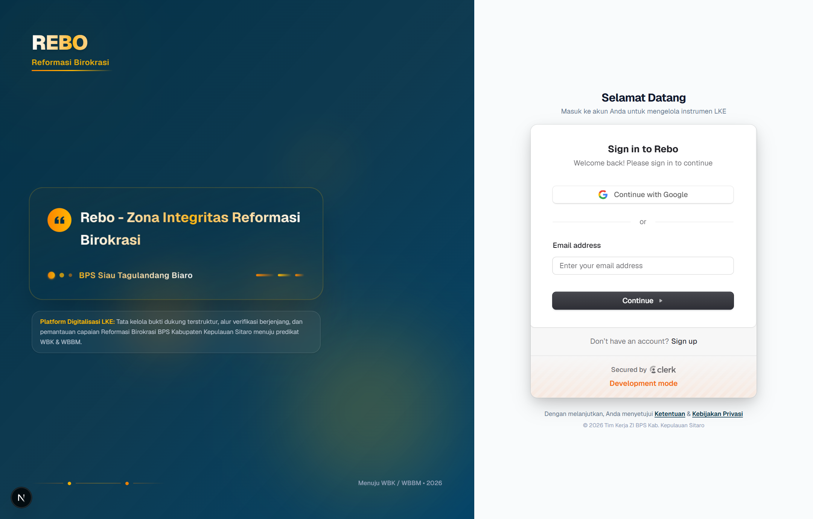
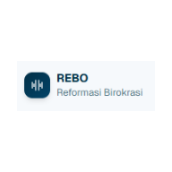

<div align="center">
  
  <h1><strong>REBO V2 — Zona Integritas & Reformasi Birokrasi</strong></h1>
  <p><strong>Platform Digitalisasi, Evaluasi, dan Verifikasi Lembar Kerja Evaluasi (LKE) Menuju WBK/WBBM</strong></p>
  <p><em>Badan Pusat Statistik (BPS) Kabupaten Kepulauan Siau Tagulandang Biaro (Sitaro), Sulawesi Utara</em></p>
  <br />
  
  <br />
  <p>
    <a href="#-fitur-utama-v2">Fitur Utama</a> •
    <a href="#-sinergi--integrasi-dengan-web-rb-pusat-pmprb">Integrasi Web Pusat</a> •
    <a href="#-tangkapan-layar--antarmuka-aplikasi">Tangkapan Layar</a> •
    <a href="#-arsitektur--tech-stack">Arsitektur</a> •
    <a href="#-struktur-modul--navigasi">Modul Sistem</a> •
    <a href="#-role-based-access-control-rbac">Hak Akses</a> •
    <a href="#-panduan-migrasi-database--data-seeding">Migrasi & Seeding</a> •
    <a href="#-instalasi--cara-menjalankan-aplikasi">Cara Menjalankan</a> •
    <a href="#-skrip-otomasi--utilitas-proyek">Skrip Utilitas</a> •
    <a href="#-dokumentasi-lengkap">Dokumentasi</a>
  </p>
</div>

---

## 🌟 Tentang REBO V2

**REBO (Reformasi Birokrasi) Versi 2.0.0** adalah sistem otomasi tata kelola bukti dukung, pemantauan progress, dan verifikasi penilaian Lembar Kerja Evaluasi (LKE) PMPRB BPS Kabupaten Kepulauan Sitaro. Platform ini bertransisi dari penataan dokumen manual dan tautan statis menjadi platform evaluasi terpusat yang aman, transparan, dan terintegrasi penuh dengan struktur hierarkis Google Drive resmi, alur review berjenjang, Kanban Board tindak lanjut, visualisasi capaian interaktif, ekspor resmi standar KemenPAN-RB, serta aksesibilitas mobile melalui Progressive Web App (PWA).

---

## 📸 Tangkapan Layar & Antarmuka Aplikasi

<div align="center">
  <h3>Pratinjau Dasbor Web & Visualisasi Progres</h3>
  
</div>

<div align="center">
  <table style="border: none; margin: 0 auto;">
    <tr align="center">
      <td width="50%" style="vertical-align: top; padding: 12px;">
        
        <br />
        <strong>Identitas Resmi REBO</strong>
        <p style="font-size: 13px; color: #64748b;">Logo dan identitas visual Reformasi Birokrasi BPS Kabupaten Kepulauan Sitaro</p>
      </td>
      <td width="50%" style="vertical-align: top; padding: 12px;">
        
        <br />
        <strong>Mobile PWA Standalone Icon</strong>
        <p style="font-size: 13px; color: #64748b;">Aplikasi siap pasang di perangkat smartphone Android & iOS tim kerja lapangan</p>
      </td>
    </tr>
  </table>
</div>

---

## 🚀 Fitur Utama V2

1. **Multi-Periode Lifecycle Management**:
   - Isolasi data evaluasi tahun berjalan (misal: 2025, 2026, 2027) tanpa redundansi atau risiko tertimpa.
   - Penguncian periode lampau (*Lock/Freeze*) menjadi *read-only* demi menjaga keutuhan arsip reviu.
   - Fasilitas kloning/duplikasi hierarki indikator lintas tahun anggaran baru dengan satu klik (*1-Click Clone*).
   - Global switcher periode di header navigasi yang responsif di seluruh halaman.

2. **Role-Based Access Control (RBAC) Terstruktur**:
   - Pembagian hak akses granular: **Super Admin**, **Koordinator Pilar**, **Operator (Tim Kerja)**, dan **TPI (Inspektorat/Verifikator Eksternal)**.
   - Validasi keamanan berlapis pada level `middleware.ts`, Next.js Server Actions, dan Client UI.

3. **Generator Hierarki Google Drive per Indikator**:
   - Tiap indikator/pertanyaan memiliki 1 tautan folder Google Drive khusus:
     `REBO_[TAHUN] > [AREA] > [PILAR] > [SUBPILAR] > [IND_KODE - NAMA_INDIKATOR]`.
   - Generator otomatis skrip Google Apps Script (GAS) untuk instan provisioning seluruh pohon folder fisik di Google Drive instansi.
   - One-click navigation langsung ke folder Google Drive dari masing-masing butir pertanyaan di Form LKE.

4. **Multi-Dokumen Bukti & Penilaian Mandiri Real-Time**:
   - Input berkas bukti fleksibel (SK, Notula, SOP, Undangan, Foto, dsb.) dalam satu pertanyaan.
   - Perhitungan otomatis nilai skor mandiri sesuai kategori pilihan jawaban.
   - Mekanisme penyimpanan Draft dan Pengiriman Review resmi.

5. **Verifikasi Koordinator & Feedback Loop Ketat**:
   - Proteksi total terhadap field catatan koordinator dan tombol status dari perubahan oleh Operator biasa.
   - Aturan bisnis: Catatan revisi wajib diisi (minimal 5 karakter) apabila status ditetapkan menjadi **Perlu Revisi (Ditolak)**.
   - Sistem penilaian ganda (**Dual-Scoring**): membandingkan Nilai Mandiri (usulan) vs Nilai Verifikasi (final) beserta kalkulasi deviasi.

6. **Kanban Board Tindak Lanjut Terintegrasi**:
   - Indikator berstatus 'Perlu Revisi' otomatis masuk ke kolom **To Do** pada `/rebo/kanban`.
   - Filter kartu per pilar dan pencarian instan untuk mempercepat koordinasi tim pilar.
   - Tampilan bernuansa pastel modern yang nyaman digunakan sehari-hari.

7. **Monitoring Real-Time & Visualisasi Interaktif**:
   - Kartu KPI komparasi akumulasi skor Mandiri vs Verifikasi vs Nilai Maksimal LKE.
   - Grafik interaktif Recharts (Bar Chart capaian pilar dan Donut Chart status kelengkapan).
   - Tabel rincian progres per pilar dan subpilar.

8. **Ekspor Kertas Kerja LKE Resmi Standar KemenPAN-RB**:
   - Unduh laporan lengkap dalam format Excel (`.xlsx`) via `exceljs` berformat resmi 2 sheet (Kertas Kerja LKE & Ringkasan Capaian) dengan header instansi, border, formatting sel rapi, dan tautan bukti aktif.
   - Modul arsip dinamis (`/rebo/arsip`) berbasis database dengan filter tahun/kategori.

9. **CRUD Master Data LKE Lengkap**:
   - Pengelolaan penuh Pilar, Subpilar, Pertanyaan, serta Opsi Jawaban & Bobot Nilai (Kategori Penilaian) pada menu `/rebo/dataRB`.
   - Proteksi *Safe Deletion* (mencegah penghapusan induk jika anak relasi masih ada) dan pemetaan kolom PostgreSQL asli secara presisi.

10. **Pusat Informasi & Bagan Hierarki Struktur RB**:
    - Halaman komprehensif `/rebo/informasi` dengan gaya visual *soft-neutral* elegan dan ramah dibaca.
    - Bagan hierarki interaktif (*React Flow / Interactive Graph*) untuk membedah keterkaitan Komponen, Area, Pilar, Subpilar, Indikator, hingga Bukti Dukung.
    - Glosarium istilah ZI dan pedoman PermenPAN-RB No. 90/2021.

11. **Progressive Web App (PWA) & Mobile Ready**:
    - Dapat diinstal di smartphone Android/iOS pimpinan dan tim kerja lapangan (*standalone app*).
    - Splash screens, icon adaptif (maskable 192px & 512px), dan caching Service Worker offline-ready via Workbox.

---

## 🔄 Sinergi & Integrasi dengan Web RB Pusat (PMPRB)

Meskipun sudah ada portal pengumpulan evaluasi RB dari pusat (misal: PMPRB Nasional/Kementerian), **REBO V2 diposisikan sebagai *Internal Staging & Collaboration Workspace*** bagi tim kerja satker, sementara **Web RB Pusat adalah *Final Reporting Gate*** bagi asesor nasional.

```
[ Kerja Tim Satker ] ➔ [ REBO V2 (Pre-Audit, GDrive Guard, QA) ] ➔ [ Auto-Submit / Ekstensi ] ➔ [ Web RB Pusat ]
```

### 🎯 Nilai Tambah Utama yang Tidak Dimiliki Web Pusat:
1. **Google Drive Permission Guard (Health Checker):**
   - Mendeteksi otomatis apakah link Google Drive berstatus publik (*Anyone with the link can view*) atau masih terkunci (*Restricted*), mencegah bukti dukung ditolak asesor karena akses ditutup.
2. **Pre-Submission QA Checklist:**
   - Mewajibkan pemenuhan berkas kunci (Undangan, Daftar Hadir, Notula, Laporan, Foto) sebelum status indikator disetujui internal untuk dikirim ke pusat.
3. **Alur Reviu Berjenjang Internal Satker:**
   - Mekanisme verifikasi 3 lapis: `Operator Pilar` ➔ `Koordinator Pilar` ➔ `TPI / Asesor Internal`.
4. **Tindak Lanjut via Kanban Otomatis:**
   - Rekomendasi/catatan revisi langsung terkonversi menjadi kartu tugas berbatas waktu (*deadline*).

### 🤖 Mekanisme Jembatan & Auto-Submit ke Web Pusat:
- **REBO Chrome Extension (Sync Assistant — Direkomendasikan):** Ekstensi browser ringan yang membaca data link REBO yang sudah *verified*, lalu mengisikan form pada Web RB Pusat secara otomatis (*auto-fill*) dengan 1 klik tanpa kendala CAPTCHA/SSO.
- **RPA / Headless Browser Worker:** Skrip otomatisasi (Puppeteer/Playwright) untuk proses submit batch berkala.
- **Submission Status Tracking:** Status indikator tercatat transparan: `Draft` ➔ `Verified Internal` ➔ `Siap Kirim` ➔ `Tersinkron ke Pusat` lengkap dengan bukti *audit log*.

> 📖 **Pelajari arsitektur dan perbandingan lengkap:**  
> Silakan baca dokumentasi khusus pada **[INTEGRASI_DAN_DIFERENSIASI_WEB_PUSAT.md](INTEGRASI_DAN_DIFERENSIASI_WEB_PUSAT.md)**.

---

## 🛠️ Arsitektur & Tech Stack

| Layer | Teknologi | Peran & Justifikasi |
|---|---|---|
| **Framework** | Next.js 15.3.9 (App Router, Turbopack) | Server Components (RSC), Server Actions aman, patch keamanan CVE terbaru |
| **Bahasa & Runtime** | TypeScript 5.7+ / React 19 | Type-safety end-to-end dan asynchronous form actions modern |
| **Styling & UI Kit** | Tailwind CSS v4, shadcn/ui, Radix UI | Desain responsif modern, palet netral elegan, dukungan Light/Dark theme |
| **Autentikasi & RBAC** | Clerk Authentication | Manajemen sesi aman, SSO, dan metadata peran pengguna |
| **Database & API** | Supabase (PostgreSQL 17.4) | Database relational, PostgREST API, Row-Level Security (RLS) |
| **Direct DB Client** | `pg` (node-postgres) | Eksekusi DDL migrasi otomatis dan data seeding langsung dari CLI |
| **Visualisasi Data** | Recharts 2.15+ | Grafik analitik progress pilar dan distribusi status LKE |
| **Ekspor Dokumen** | ExcelJS | Ekspor format resmi Kertas Kerja LKE (.xlsx) standar KemenPAN-RB |
| **PWA Engine** | next-pwa (Workbox) | Dukungan instalasi aplikasi web dan caching service worker |
| **Observabilitas** | Sentry Next.js v9 | Error tracking real-time dan monitoring stabilitas produksi |

---

## 🧭 Struktur Modul & Navigasi

```plaintext
/rebo
├── /overview                   # Dashboard utama ringkasan sistem, KPI, & quick actions
├── /formRB
│   ├── /area                   # Pemilihan Area (Pengungkit - Pemenuhan & Reform)
│   ├── /pemenuhan              # Daftar Pilar 1 s.d. 6 Area Pemenuhan
│   ├── /reform                 # Daftar Pilar 1 s.d. 6 Area Reform
│   └── /[pilarId]              # Formulir LKE terperinci (Multi-bukti, skor mandiri, verifikasi)
├── /pilarHasil                 # Input dan evaluasi Aspek Hasil ZI
├── /monitoring                 # Dashboard analitik progress, visualisasi chart, & export Excel
├── /kanban                     # Papan Kanban tindak lanjut perbaikan indikator LKE
├── /arsip                      # Dynamic archive dokumen, SK, dan kertas kerja historis
├── /informasi                  # Pusat panduan, regulasi, bagan hierarki interaktif, dan FAQ
├── /dataRB                     # CRUD Master Data LKE (Super Admin)
│   ├── /pilar                  # Kelola Master Pilar Area Pemenuhan & Reform
│   ├── /pilar/subpilar         # Kelola Master Subpilar
│   └── /pilar/pertanyaan       # Kelola Master Indikator & Bobot Opsi Kategori
└── /admin                      # Khusus Super Admin
    ├── /periode                # Manajemen siklus tahun evaluasi LKE & duplikasi indikator
    ├── /gdrive-generator       # Generator hierarki Google Drive per indikator
    ├── /audit-log              # Log rekam jejak mutasi data dan aktivitas sistem
    └── /api/role               # Manajemen assignment role dan pilar pengguna Clerk
```

---

## 👥 Role-Based Access Control (RBAC)

| Peran (Role) | Hak Akses Utama |
|---|---|
| **Super Admin** | Akses penuh seluruh sistem: manajemen user & role, manajemen periode evaluasi, audit log, master data pilar/indikator, dan generator Google Drive. |
| **Koordinator Pilar** | Memverifikasi bukti dukung, menyetujui/menolak bukti, memberikan catatan revisi wajib, dan menetapkan skor verifikasi pada pilar yang ditugaskan. |
| **Operator (Tim Kerja)** | Mengisi jawaban LKE, mengunggah multi-dokumen bukti dukung, memilih nilai mandiri, dan menindaklanjuti revisi pada Kanban. |
| **TPI / Verifikator** | Hak akses reviu dan audit independen lintas pilar untuk inspektorat atau tim penilai internal. |

---

## 🗄️ Panduan Migrasi Database & Data Seeding

Database REBO V2 berjalan di atas Supabase PostgreSQL dengan dukungan migrasi langsung maupun manual.

### 1. Migrasi Otomatis (Menggunakan Direct Connection)
Pastikan `DATABASE_URL` sudah terisi di `.env.local`, kemudian jalankan skrip migrasi:
```bash
node scripts/apply_v2_migration.js
```
*Skrip ini akan secara otomatis membuat tabel `periode_evaluasi`, `pertanyaan_periode`, `dokumen_bukti`, `audit_log`, `arsip_dokumen`, function trigger `updated_at`, dan aturan RLS.*

### 2. Seeding Data Lengkap & Pemeliharaan Data Historis
Untuk menyinkronkan data lama dari tabel `buktiDukung` serta mengisi data peraga realistis pada Monitoring, Kanban, dan Arsip:
```bash
node scripts/seed_rich_data.js
```
*Hasil seeding:*
- **37 Indikator Disetujui (Done)**
- **37 Indikator Menunggu Review (In Review)**
- **5 Indikator Perlu Revisi (To Do)**
- **31 Indikator Belum Diisi**
- **75 Dokumen Bukti Dukung Multi-Files**
- **5 Dokumen Arsip Resmi** (SK Tim ZI 2026, Rencana Aksi, SOP Inovasi, LKjIP, Pedoman PermenPAN-RB)

### 3. Migrasi Manual via Supabase Dashboard
Jika ingin menjalankan migrasi melalui **SQL Editor** pada [Supabase Dashboard](https://supabase.com/dashboard):
- Jalankan file: [supabase/migrations/20261121000000_rebo_v2_schema.sql](supabase/migrations/20261121000000_rebo_v2_schema.sql)
- Jalankan file: [supabase/migrations/20261121000001_arsip_dokumen.sql](supabase/migrations/20261121000001_arsip_dokumen.sql)

---

## 💻 Instalasi & Cara Menjalankan Aplikasi

### Kebutuhan Dasar
- **Node.js**: Versi 20.x atau 22.x LTS
- **Package Manager**: `pnpm` (disarankan) atau `npm`

### Langkah-Langkah Menjalankan:
1. **Clone repositori**:
   ```bash
   git clone https://github.com/aljaffarsyah10/rebo.git
   cd rebo
   ```

2. **Pasang seluruh dependensi**:
   ```bash
   pnpm install
   ```

3. **Siapkan file konfigurasi environment**:
   - Di Windows PowerShell:
     ```powershell
     Copy-Item env.example.txt .env.local
     ```
   - Di Linux / macOS:
     ```bash
     cp env.example.txt .env.local
     ```
   *Buka `.env.local` dan isi kredensial Clerk, Supabase, dan Sentry.*

4. **Verifikasi integritas kode**:
   ```bash
   # Cek tipe data TypeScript
   npx tsc --noEmit

   # Cek linter
   pnpm lint

   # Verifikasi build produksi (opsional)
   pnpm build
   ```

5. **Jalankan development server**:
   ```bash
   pnpm dev
   ```
   Akses di browser: `http://localhost:3000`

---

## 🔧 Skrip Otomasi & Utilitas Proyek

Di dalam direktori `scripts/` tersedia serangkaian skrip otomasi untuk mempermudah operasional:

| Skrip | Perintah Eksekusi | Deskripsi & Fungsi |
|---|---|---|
| **Backup Supabase Live** | `node scripts/backup_supabase.js` | Mengambil snapshot penuh data remote Supabase ke format JSON & SQL (`supabase/backups/`) |
| **Apply V2 Migration** | `node scripts/apply_v2_migration.js` | Menjalankan migrasi DDL pembuatan tabel V2 langsung ke server PostgreSQL Supabase |
| **Seed Rich Data** | `node scripts/seed_rich_data.js` | Mengisi data peraga realistis dan menyinkronkan data lama ke periode berjalan |

---

## 🌐 Daftar Tautan Cepat Navigasi Lokal

Setelah server berjalan (`http://localhost:3000`), Anda dapat langsung mengakses modul-modul berikut:

- **Beranda / Overview:** [http://localhost:3000/rebo/overview](http://localhost:3000/rebo/overview)
- **Monitoring Capaian & Ekspor Excel:** [http://localhost:3000/rebo/monitoring](http://localhost:3000/rebo/monitoring)
- **Kanban Tindak Lanjut Revisi:** [http://localhost:3000/rebo/kanban](http://localhost:3000/rebo/kanban)
- **Formulir Pengisian Bukti (Area):** [http://localhost:3000/rebo/formRB/area](http://localhost:3000/rebo/formRB/area)
- **Pusat Informasi & Bagan Struktur Hierarki:** [http://localhost:3000/rebo/informasi](http://localhost:3000/rebo/informasi)
- **Katalog Arsip Digital:** [http://localhost:3000/rebo/arsip](http://localhost:3000/rebo/arsip)
- **Kelola Master Data LKE:** [http://localhost:3000/rebo/dataRB/pilar](http://localhost:3000/rebo/dataRB/pilar)
- **Admin Panel:**
  - Manajemen Pengguna: [http://localhost:3000/rebo/admin](http://localhost:3000/rebo/admin)
  - Generator Folder GDrive: [http://localhost:3000/rebo/admin/gdrive-generator](http://localhost:3000/rebo/admin/gdrive-generator)
  - Manajemen Siklus Periode: [http://localhost:3000/rebo/admin/periode](http://localhost:3000/rebo/admin/periode)
  - Audit Trail & Log Aktivitas: [http://localhost:3000/rebo/admin/audit-log](http://localhost:3000/rebo/admin/audit-log)

---

## ⚙️ Environment Variables

Berikut daftar variabel lingkungan yang dibutuhkan pada `.env.local`:

```env
# Clerk Authentication
NEXT_PUBLIC_CLERK_PUBLISHABLE_KEY=pk_test_...
CLERK_SECRET_KEY=sk_test_...
NEXT_PUBLIC_CLERK_SIGN_IN_URL=/auth/sign-in
NEXT_PUBLIC_CLERK_SIGN_UP_URL=/auth/sign-up
NEXT_PUBLIC_CLERK_AFTER_SIGN_IN_URL=/rebo/overview
NEXT_PUBLIC_CLERK_AFTER_SIGN_UP_URL=/rebo/overview

# Supabase (PostgreSQL Database)
NEXT_PUBLIC_SUPABASE_URL=https://your-project.supabase.co
NEXT_PUBLIC_SUPABASE_ANON_KEY=eyJhbGciOi...
SUPABASE_SERVICE_ROLE_KEY=
DATABASE_URL=postgresql://postgres:[PASSWORD]@[HOST]:5432/postgres

# Sentry Monitoring (Opsional untuk dev, disarankan untuk production)
NEXT_PUBLIC_SENTRY_DSN=https://...@sentry.io/...
SENTRY_AUTH_TOKEN=sntrys_...
NEXT_PUBLIC_SENTRY_ORG=your-sentry-org
NEXT_PUBLIC_SENTRY_PROJECT=rebo
NEXT_PUBLIC_SENTRY_DISABLED="false"
```

---

## 📱 Optimasi PWA (Progressive Web App)

REBO V2 dikonfigurasikan agar dapat diinstal langsung di perangkat *smartphone* maupun *desktop*:
- **Web App Manifest**: Dideklarasikan pada `/manifest.json` dengan dukungan maskable icons (192px dan 512px).
- **Theme Color**: Menggunakan warna resmi Navy BPS (`#003366`) pada mode terang dan `#09090b` pada mode gelap.
- **Service Worker**: Dikelola secara otomatis oleh Workbox melalui `next-pwa` dengan strategi cache teroptimasi.

---

## 📚 Dokumentasi Lengkap

Untuk informasi perencanaan, arsitektur, dan riwayat pengembangan terperinci, silakan merujuk ke dokumen berikut:
- **[Sinergi, Diferensiasi & Jembatan Integrasi Web RB Pusat](INTEGRASI_DAN_DIFERENSIASI_WEB_PUSAT.md)**
- **[PRD & Sequential Development Playbook V2](Prep%20PRD%20and%20Playbook%20V2/PRD%20and%20Playbook%20REBO%20V2.md)**
- **[Catatan Rilis Resmi (Release Notes v2.0.0)](Prep%20PRD%20and%20Playbook%20V2/REBO_V2_RELEASE_NOTES.md)**
- **[Analisis Kebutuhan Awal](Prep%20PRD%20and%20Playbook%20V2/Analisis%20Kebutuhan.md)**
- **[Panduan Migrasi Database V2](supabase/README_MIGRATION_V2.md)**

---

## 📄 Lisensi & Hak Cipta

Dikembangkan oleh **Tim Pembangunan Zona Integritas & Reformasi Birokrasi — BPS Kabupaten Kepulauan Siau Tagulandang Biaro (Sitaro)**.  
Hak Cipta © 2026 BPS Kabupaten Kepulauan Sitaro. Seluruh hak dilindungi undang-undang.
