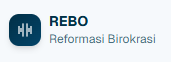

<div align="center">
  
  <h1><strong>REBO V2 — Zona Integritas & Reformasi Birokrasi</strong></h1>
  <p><strong>Platform Digitalisasi, Evaluasi, dan Verifikasi Lembar Kerja Evaluasi (LKE) Menuju WBK/WBBM</strong></p>
  <p><em>Badan Pusat Statistik (BPS) Kabupaten Kepulauan Siau Tagulandang Biaro (Sitaro), Sulawesi Utara</em></p>
  <p>
    <a href="#-fitur-utama-v2">Fitur Utama</a> •
    <a href="#-arsitektur--tech-stack">Arsitektur</a> •
    <a href="#-struktur-modul--navigasi">Modul Sistem</a> •
    <a href="#-role-based-access-control-rbac">Hak Akses</a> •
    <a href="#-instalasi--menjalankan-aplikasi">Instalasi</a> •
    <a href="#-environment-variables">Konfigurasi Env</a>
  </p>
</div>

---

## 🌟 Tentang REBO V2

**REBO (Reformasi Birokrasi) Versi 2.0.0** adalah sistem otomasi tata kelola bukti dukung, pemantauan progress, dan verifikasi penilaian Lembar Kerja Evaluasi (LKE) PMPRB BPS Kabupaten Kepulauan Sitaro. Platform ini bertransisi dari penataan dokumen manual dan tautan statis menjadi platform evaluasi terpusat yang aman, transparan, dan terintegrasi penuh dengan struktur hierarkis Google Drive resmi, alur review berjenjang, Kanban Board tindak lanjut, visualisasi capaian interaktif, ekspor resmi standar KemenPAN-RB, serta aksesibilitas mobile melalui Progressive Web App (PWA).

---

## 🚀 Fitur Utama V2

1. **Multi-Periode Lifecycle Management**:
   - Isolasi data evaluasi tahun berjalan (misal: 2025, 2026, 2027) tanpa redundansi atau risiko tertimpa.
   - Penguncian periode lampau (*Lock/Freeze*) menjadi *read-only* demi menjaga keutuhan arsip reviu.
   - Fasilitas kloning/duplikasi hierarki indikator lintas tahun anggaran baru dengan satu klik.
   - Global switcher periode di header navigasi yang responsif di seluruh halaman.

2. **Role-Based Access Control (RBAC) Terstruktur**:
   - Pembagian hak akses granular: **Super Admin**, **Koordinator Pilar**, **Operator (Tim Kerja)**, dan **TPI (Inspektorat/Verifikator Eksternal)**.
   - Validasi keamanan berlapis pada level `middleware.ts`, Next.js Server Actions, dan Client UI.

3. **Generator Hierarki Google Drive per Indikator**:
   - Otomatisasi pembentukan tautan dan struktur folder terstandar: `BPS-7108/RB/{Tahun}/{Area}/{Pilar}/{Kode_Indikator}`.
   - One-click navigation langsung ke folder Google Drive dari masing-masing butir pertanyaan.
   - Panduan izin akses domain `@bps.go.id`.

4. **Multi-Dokumen Bukti & Penilaian Mandiri Real-Time**:
   - Input berkas bukti fleksibel (SK, Notula, SOP, Undangan, Foto, dsb.) dalam satu pertanyaan.
   - Perhitungan otomatis nilai skor mandiri sesuai kategori pilihan jawaban.
   - Mekanisme penyimpanan Draft dan Pengiriman Review resmi.

5. **Verifikasi Koordinator & Feedback Loop Ketat**:
   - Proteksi total terhadap field catatan koordinator dan tombol status dari perubahan oleh Operator biasa.
   - Aturan bisnis: Catatan revisi wajib diisi (minimal 5 karakter) apabila status ditetapkan menjadi **Perlu Revisi (Ditolak)**.
   - Aksi cepat menyamakan skor verifikasi dengan skor mandiri saat bukti dinyatakan valid.

6. **Kanban Board Tindak Lanjut Terintegrasi**:
   - Indikator berstatus 'Perlu Revisi' otomatis masuk ke kolom **To Do** pada `/rebo/kanban`.
   - Filter kartu per pilar dan pencarian instan untuk mempercepat koordinasi tim pilar.

7. **Monitoring Real-Time & Visualisasi Interaktif**:
   - Kartu KPI komparasi akumulasi skor Mandiri vs Verifikasi vs Nilai Maksimal LKE.
   - Grafik interaktif Recharts (Bar Chart capaian pilar dan Donut Chart status kelengkapan).
   - Tabel rincian progres per pilar dan subpilar.

8. **Ekspor Kertas Kerja LKE Resmi Standar KemenPAN-RB**:
   - Unduh laporan lengkap dalam format Excel (`.xlsx`) berformat resmi dengan header instansi, formatting sel rapi, dan tautan bukti aktif.
   - Modul arsip dinamis untuk mengunduh rekapitulasi evaluasi historis.

9. **Progressive Web App (PWA) & Mobile Ready**:
   - Dapat diinstal di smartphone Android/iOS pimpinan dan tim kerja lapangan (*standalone app*).
   - Splash screens, icon adaptif, dan caching Service Worker offline-ready via Workbox.

---

## 🛠️ Arsitektur & Tech Stack

| Layer | Teknologi | Peran & Justifikasi |
|---|---|---|
| **Framework** | Next.js 15.3 (App Router, Turbopack) | Server Components (RSC), Server Actions aman, route optimization |
| **Bahasa & Runtime** | TypeScript 5.7+ / React 19 | Type-safety end-to-end dan asynchronous form actions modern |
| **Styling & UI Kit** | Tailwind CSS v4, shadcn/ui, Radix UI | Desain responsif modern, dukungan Light/Dark theme konsisten |
| **Autentikasi & RBAC** | Clerk Authentication | Manajemen sesi aman, SSO, dan metadata peran pengguna |
| **Database** | Supabase (PostgreSQL 15+) | Relasi data kuat, Row-Level Security, audit logging |
| **Visualisasi Data** | Recharts 2.15+ | Grafik analitik progress pilar dan distribusi status LKE |
| **Ekspor Dokumen** | ExcelJS | Ekspor format resmi Kertas Kerja LKE (.xlsx) standar KemenPAN-RB |
| **PWA Engine** | next-pwa (Workbox) | Dukungan instalasi aplikasi web dan caching service worker |
| **Observabilitas** | Sentry Next.js v9 | Error tracking real-time dan monitoring stabilitas produksi |

---

## 🧭 Struktur Modul & Navigasi

```plaintext
/rebo
├── /overview                   # Dashboard utama ringkasan sistem, KPI, & quick actions
├── /formRB
│   ├── /area                   # Pemilihan Area (Pengungkit - Pemenuhan & Reform)
│   ├── /pemenuhan              # Daftar Pilar 1 s.d. 6 Area Pemenuhan
│   ├── /reform                 # Daftar Pilar 1 s.d. 6 Area Reform
│   └── /[pilarId]              # Formulir LKE terperinci (Multi-bukti, skor mandiri, verifikasi)
├── /pilarHasil                 # Input dan evaluasi Aspek Hasil ZI
├── /monitoring                 # Dashboard analitik progress, visualisasi chart, & export Excel
├── /kanban                     # Papan Kanban tindak lanjut perbaikan indikator LKE
├── /arsip                      # Dynamic archive dokumen, SK, dan kertas kerja historis
└── /admin                      # Khusus Super Admin
    ├── /periode                # Manajemen siklus tahun evaluasi LKE & duplikasi indikator
    ├── /gdrive-generator       # Generator hierarki Google Drive per indikator
    ├── /audit-log              # Log rekam jejak mutasi data dan aktivitas sistem
    └── /api/role               # Manajemen assignment role dan pilar pengguna Clerk
```

---

## 👥 Role-Based Access Control (RBAC)

| Peran (Role) | Hak Akses Utama |
|---|---|
| **Super Admin** | Akses penuh seluruh sistem: manajemen user & role, manajemen periode evaluasi, audit log, master data pilar/indikator, dan generator Google Drive. |
| **Koordinator Pilar** | Memverifikasi bukti dukung, menyetujui/menolak bukti, memberikan catatan revisi, dan menetapkan skor verifikasi pada pilar yang ditugaskan. |
| **Operator (Tim Kerja)** | Mengisi jawaban LKE, mengunggah multi-dokumen bukti dukung, memilih nilai mandiri, dan menindaklanjuti revisi pada Kanban. |
| **TPI / Observer** | Hak akses reviu dan audit read-only lintas pilar untuk inspektorat atau penilai eksternal. |

---

## 💻 Instalasi & Menjalankan Aplikasi

### Kebutuhan Dasar
- **Node.js**: Versi 20.x atau 22.x LTS
- **Package Manager**: `pnpm` (disarankan) atau `npm`

### Langkah-Langkah:
1. **Clone repositori**:
   ```bash
   git clone https://github.com/aljaffarsyah10/rebo.git
   cd rebo
   ```

2. **Pasang seluruh dependensi**:
   ```bash
   pnpm install
   ```

3. **Siapkan file konfigurasi environment**:
   ```bash
   cp env.example.txt .env.local
   ```
   *Buka `.env.local` dan isi kredensial Clerk, Supabase, dan Sentry.*

4. **Verifikasi kode**:
   ```bash
   # Cek tipe data
   npx tsc --noEmit

   # Cek linter
   pnpm lint

   # Verifikasi build produksi
   pnpm build
   ```

5. **Jalankan development server**:
   ```bash
   pnpm dev
   ```
   Akses di browser: `http://localhost:3000`

---

## ⚙️ Environment Variables

Berikut daftar variabel lingkungan yang dibutuhkan:

```env
# Clerk Authentication
NEXT_PUBLIC_CLERK_PUBLISHABLE_KEY=pk_test_...
CLERK_SECRET_KEY=sk_test_...
NEXT_PUBLIC_CLERK_SIGN_IN_URL=/auth/sign-in
NEXT_PUBLIC_CLERK_SIGN_UP_URL=/auth/sign-up
NEXT_PUBLIC_CLERK_AFTER_SIGN_IN_URL=/rebo/overview
NEXT_PUBLIC_CLERK_AFTER_SIGN_UP_URL=/rebo/overview

# Supabase (PostgreSQL Database)
NEXT_PUBLIC_SUPABASE_URL=https://your-project.supabase.co
NEXT_PUBLIC_SUPABASE_ANON_KEY=eyJhbGciOi...
SUPABASE_SERVICE_ROLE_KEY=eyJhbGciOi...

# Sentry Monitoring (Opsional untuk dev, disarankan untuk production)
NEXT_PUBLIC_SENTRY_DSN=https://...@sentry.io/...
SENTRY_AUTH_TOKEN=sntrys_...
NEXT_PUBLIC_SENTRY_ORG=your-sentry-org
NEXT_PUBLIC_SENTRY_PROJECT=rebo
```

---

## 📱 Optimasi PWA (Progressive Web App)

REBO V2 dikonfigurasikan agar dapat diinstal langsung di perangkat *smartphone* maupun *desktop*:
- **Web App Manifest**: Dideklarasikan pada `/manifest.json` dengan dukungan maskable icons (192px dan 512px).
- **Theme Color**: Menggunakan warna resmi Navy BPS (`#003366`) pada mode terang dan `#09090b` pada mode gelap.
- **Service Worker**: Dikelola secara otomatis oleh Workbox melalui `next-pwa` dengan strategi cache teroptimasi.

---

## 📄 Lisensi & Hak Cipta

Dikembangkan oleh **Tim Pembangunan Zona Integritas & Reformasi Birokrasi — BPS Kabupaten Kepulauan Siau Tagulandang Biaro (Sitaro)**.  
Hak Cipta © 2026 BPS Kabupaten Kepulauan Sitaro. Seluruh hak dilindungi undang-undang.
